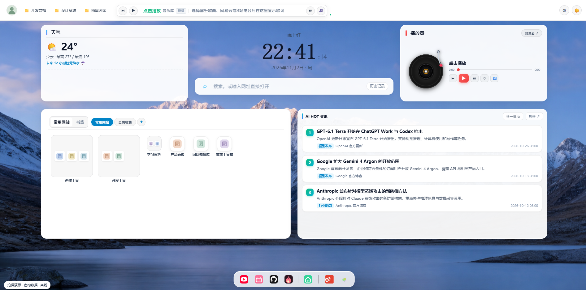
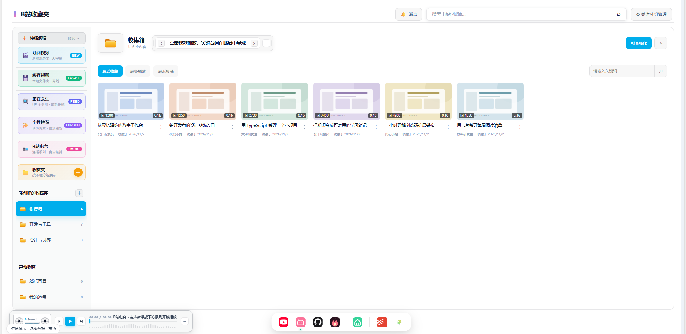
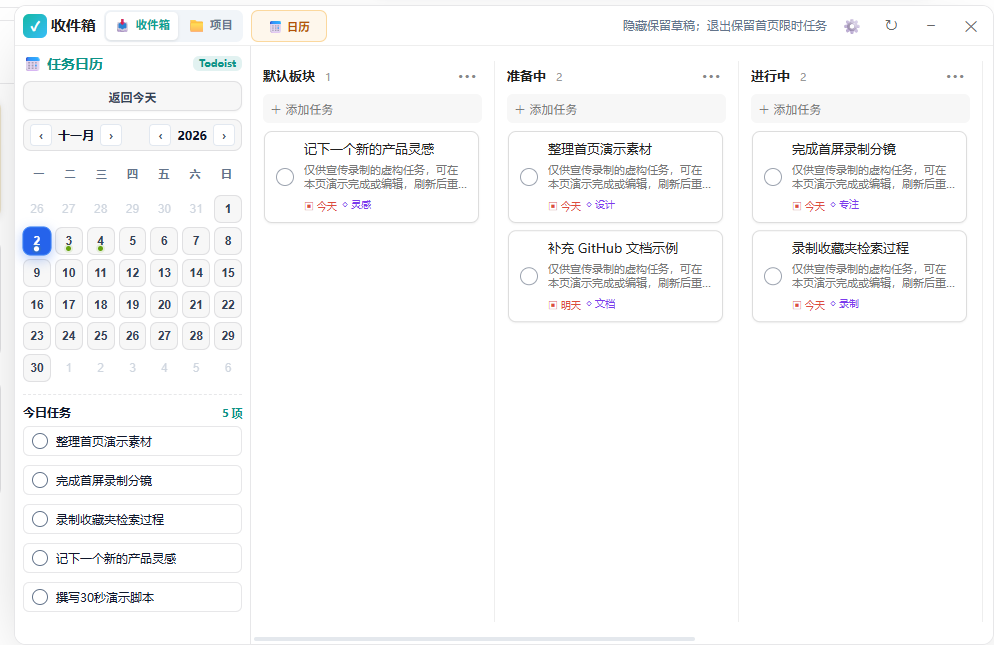

# tab-project

<p align="center">
  
</p>

<p align="center"><strong>以浏览器新标签页为核心的个人生产力工作台</strong></p>

<p align="center">
  <a href="https://chromewebstore.google.com/detail/tab-project-%E6%96%B0%E6%A0%87%E7%AD%BE%E9%A1%B5/hogpkihhicjhiakkgjkbchpdoicmbolj"></a>
  <a href="https://microsoftedge.microsoft.com/addons/detail/tabproject-%E6%96%B0%E6%A0%87%E7%AD%BE%E9%A1%B5/dbkaiojfbolnkpaegflocfbdgpmhjcco"></a>
</p>

<p align="center">
  <a href="README_en.md">English</a> · <strong>简体中文</strong>
</p>

<p align="center">
  <a href="https://chromewebstore.google.com/detail/tab-project-%E6%96%B0%E6%A0%87%E7%AD%BE%E9%A1%B5/hogpkihhicjhiakkgjkbchpdoicmbolj"><strong>Chrome 商店安装</strong></a> ·
  <a href="https://microsoftedge.microsoft.com/addons/detail/tabproject-%E6%96%B0%E6%A0%87%E7%AD%BE%E9%A1%B5/dbkaiojfbolnkpaegflocfbdgpmhjcco"><strong>Edge 商店安装</strong></a> ·
  <a href="https://github.com/kongzhuww/tab-project/releases/latest">Release 下载</a> ·
  <a href="CHANGELOG.md">更新日志</a> ·
  <a href="#快速指引如何选择适合你的路径">快速起步</a> ·
  <a href="#安装">安装指南</a> ·
  <a href="#开发">开发说明</a>
</p>

> **核心定位**：tab-project 是一个基于 **Vue 3、TypeScript 和 Chromium Manifest V3** 的浏览器新标签页工作台（面向 Chrome / Edge）。它优先解决**常用网站、书签看板、日常任务和多媒体工具分散在多个页面**的割裂痛点，在一个清爽、自适应主题的统一界面中聚合高频工作流。

> **已双端上架官方应用商店**：
> - **Chrome 网上应用店**：[安装 tab-project 新标签页](https://chromewebstore.google.com/detail/tab-project-%E6%96%B0%E6%A0%87%E7%AD%BE%E9%A1%B5/hogpkihhicjhiakkgjkbchpdoicmbolj)（ID: `hogpkihhicjhiakkgjkbchpdoicmbolj`）
> - **Microsoft Edge 加载项商店**：[安装 tab-project 新标签页](https://microsoftedge.microsoft.com/addons/detail/tabproject-%E6%96%B0%E6%A0%87%E7%AD%BE%E9%A1%B5/dbkaiojfbolnkpaegflocfbdgpmhjcco)
>
> 商店安装由浏览器官方托管安全检查与自动更新，无需开启开发者模式。每次新版本仍需单独提交各商店审核，GitHub 提交或 Release 与商店版可能存在发布时间差。

> **仓库版本**：**1.0.21**，全面落地统一显式有限状态机（FSM）架构与排他性流转、Vue 3 专用状态机响应式网桥、AX 运行时诊断网桥（`__TAB_MACHINES__`）与 10 大核心交互工作区解耦，全量 195 项自动化回归测试套件。商店版本以商店页面及实际安装版本为准，可能与 GitHub Release 存在时间差。详见 [更新日志](CHANGELOG.md)。

## 反馈与更新

[报告问题](https://github.com/kongzhuww/tab-project/issues/new?template=bug_report.yml) · [功能建议](https://github.com/kongzhuww/tab-project/issues/new?template=feature_request.yml) · [使用交流](https://github.com/kongzhuww/tab-project/discussions) · [版本更新](https://github.com/kongzhuww/tab-project/releases)

反馈时请填写实际安装版本、浏览器版本与复现步骤；截图请先遮挡私人信息，勿提交 Token、Cookie 或密钥。商店安装会由 Edge 检查并获取已审核上线的更新；想收到 GitHub 发行通知，可在仓库 **Watch → Custom → Releases** 中订阅。

## 核心功能概览与状态分级

| 能力 / 模块 | 核心功能 | 状态分级 | 使用条件与说明 |
| :--- | :--- | :--- | :--- |
| **动态壁纸与Steam工坊** | 纯浏览器 Wallpaper Engine 运行时、OPFS 私有缓存 0 弹窗秒开、本地 Steam 创意工坊 (431960) 智能扫描、4K 视频/Web 交互/Scene 一键应用、128 位对数音频频谱律动、5 项 Mac 视网膜与 120Hz 高刷降温守护 | **默认可用** | 浏览器本地 OPFS 存储，支持直接关联 Steam 工坊或自定义本地壁纸目录 |
| **常用网站与大文件夹** | 多分组工作区、大文件夹（2x2）、拖拽重排、内联快速编辑标题与网址 | **默认可用** | 浏览器本地存储，基础功能完全离线可用 |
| **书签看板与检索** | 平铺展示浏览器书签、文件夹层级穿梭、拖拽管理、Worker 离线拼音/模糊检索 | **默认可用** | 需要浏览器书签读取权限，不修改未操作数据 |
| **多引擎聚合搜索** | 普通关键词合并匹配历史、书签与常用网站；支持 `/bm` 与 `/sites` 过滤；集成 GitHub、B站、网易云、企查查 | **默认可用** | 离线优先联想，提交时直达对应官网搜索引擎 |
| **首屏时钟、标语与天气** | 3D 大时钟与时区切换、6 款精选个性配色即选即显、柔和立体投影、个性标语滚轮切换、Open-Meteo 实时气温与天气 | **默认可用** | 天气通过浏览器直接向 Open-Meteo 发送只读请求，时钟支持右键菜单个性化配置 |
| **B站插件、电台与字幕流** | 双栏收藏夹整理、时间轴高亮字幕提取与点击跳转播放、悬浮台词胶囊栏拖拽、DASH 纯音频电台（~3MB）与卡顿自动切源 | **可选模块** | 基础浏览无需登录；读取个人收藏与关注需在同一浏览器登录 B站 |
| **GitHub 工作区** | Star 仓库分类与多规则检索、开阔式 Markdown README 阅读、一键关联待办 | **可选模块** | 基础查看无需鉴权；深度查询与关联任务需配置个人 GitHub Token |
| **Todoist 任务看板** | 0ms 离线直出、GitHub 关联仓库自动分层排版、任务日历与跨页面缓存实时失效 | **可选模块** | 需在设置中填写 Todoist API Token |
| **音乐工作区** | 网易云官网会话直连登录、塞壬唱片专辑库、首屏 3D 旋转唱片机与实时台词同步 | **可选模块** | 塞壬唱片默认可用；网易云需先在同一浏览器官网登录再点击连接 |
| **AI HOT 资讯** | 每日精选 AI 科技资讯热榜与沉浸阅读器，聚合最新技术前沿与深度论文精选 | **可选模块** | 默认提供精选资讯与沉浸阅读模式 |

### 可选组件与扩展服务

| 扩展能力 | 核心功能 | 状态分级 | 使用条件与说明 |
| :--- | :--- | :--- | :--- |
| **海狸聊天室** | 私有安全聊天室、共享房间、活动感知、卡片分享与受限图片消息 | **可选服务 (实验性)** | 默认关闭，需在商店手动启用；需要自备自托管 HTTPS 服务与专属邀请 |
| **我的表情包 / 表情库** | 聊天室面板选图、本地磁盘目录挂载（File System Access API）与表情库分类管理 | **辅助模块** | 默认在聊天室内部唤醒，不展示独立 Dock 图标；访问本地目录需浏览器授权 |
| **WebDAV 云漫游** | 坚果云或私有 WebDAV 云端备份，常用网站、配置与电台系列一键还原 | **可选服务** | 需自备坚果云或自建 WebDAV 服务器地址、账号与应用专用密码 |

- **全站主题系统**：严格适配主题 CSS 变量（`var(--panel)`、`var(--text)` 等），严禁黑色起手。统一由全局设置面板「04 主题与外观」集中管理系统风格切换与壁纸定制，支持 4 套正式界面主题：
  - **白天模式 (`light`)**：默认浅色白底，高可读性与通用工作台视觉；
  - **夜晚模式 (`dark`)**：沉浸暗黑背景，舒适适配暗光夜间使用；
  - **终末地风格 (`endfield`)**：工业黑灰底色与工程警示黄点缀，机能硬核质感；
  - **孤星风格 (`lonetrail`)**：米纸色质感纸面、工程网格与航天三色识别带。
  > *历史名称说明：旧版本文档中曾使用 Lone Trail / Endfield 等名称，当前主题键以源码小写为准。独立开机动画由 `startupAnimationStyle` 控制（莱茵生命 `rhinelab` / 终末地 `endfield`），与页面界面主题相互独立。*
- **模块自治**：工作区与独立模块分工明确，统一接入 `src/sdk/` 窗口、菜单、通知与图片查看器。
- **纯浏览器扩展**：Native Host、Native Messaging、专属设备探针与整套桌宠已彻底移除；音视频缓存与表情库通过浏览器标准 API 授权读写。

部分模块仍在迭代。历史文档、截图或源码中存在某个入口，不代表它已经稳定发布或默认启用。

## 界面预览

以下为使用虚构数据的演示界面，不含真实个人待办或收藏。首屏 AI 资讯标题也属于演示内容，并非新闻事实或模型发布声明；具体功能以实际安装版本为准。

### 首屏



### B站插件



### Todoist 任务看板



## 快速指引：如何选择适合你的路径？

根据你的使用场景，选择最适合的指引快速起步：

- **日常使用（推荐）**：直接从官方商店一键安装，无需解压或开启开发者模式，支持静默自动更新：
  - **Chrome 用户**：推荐直接[从 Chrome 网上应用店安装](https://chromewebstore.google.com/detail/tab-project-%E6%96%B0%E6%A0%87%E7%AD%BE%E9%A1%B5/hogpkihhicjhiakkgjkbchpdoicmbolj)。
  - **Edge 用户**：推荐直接[从 Edge 加载项商店安装](https://microsoftedge.microsoft.com/addons/detail/tabproject-%E6%96%B0%E6%A0%87%E7%AD%BE%E9%A1%B5/dbkaiojfbolnkpaegflocfbdgpmhjcco)。
- **手动安装或尝鲜 Release**：阅读 [手动安装：使用 Release 下载包](#手动安装使用-release-下载包)。
- **想参与功能开发或本地修改**：请阅读 [从源码构建](#从源码构建) 与 [本地开发指令](#开发)。
- **想部署或接入海狸私有聊天室**：请阅读 [私有聊天室服务端部署指南](server/private-chat/README.md)。
- **想了解移动端状况**：当前项目仅专注维护桌面 Chromium 扩展（Edge / Chrome），独立 Android / Capacitor 移动应用已退役归档，无需单独构建；桌面窗口已内置窄屏自适应布局。
- **想深入研究系统架构与实现**：请先阅读 [系统架构设计](ARCHITECTURE.md) 与面向开发者的 [现行真实入口说明](docs/CURRENT_STATE.md)。

## 安装

### 推荐：从官方应用商店安装（一键安装 & 自动更新）

#### 1. Google Chrome 商店
1. 打开 [tab-project 新标签页 · Chrome 网上应用店](https://chromewebstore.google.com/detail/tab-project-%E6%96%B0%E6%A0%87%E7%AD%BE%E9%A1%B5/hogpkihhicjhiakkgjkbchpdoicmbolj)。
2. 点击“添加至 Chrome”，按浏览器提示确认添加扩展。
3. 打开新标签页；若 Chrome 弹出提示询问是否保留新标签页更改，点击“保留更改”。

#### 2. Microsoft Edge 商店
1. 打开 [tab-project 新标签页 · Microsoft Edge 加载项商店](https://microsoftedge.microsoft.com/addons/detail/tabproject-%E6%96%B0%E6%A0%87%E7%AD%BE%E9%A1%B5/dbkaiojfbolnkpaegflocfbdgpmhjcco)。
2. 点击“获取”，按浏览器提示确认添加扩展。
3. 打开新标签页；若 Edge 提示确认新标签页更改，请确认保留本扩展。

> **提示**：商店安装无需开发者模式，后续由浏览器官方商店自动更新。GitHub 的源码提交、Release 发布与商店审核发布是独立流程，各平台审核周期不同，商店版更新上线可能略有差异。

**已有解压安装用户**：商店版可能使用不同的扩展 ID，不会自动继承开发版的本地数据。切换前请先导出重要配置，保留原安装，确认可恢复后再停用旧版；不要先卸载或清空原数据。

### 手动安装：使用 Release 下载包

适用于 Chrome、开发调试或需要手动管理版本的用户。下载最新 Release 附件；想参与开发或使用尚未发布的源码，再按下方步骤从源码构建。

1. 打开 [最新发行版](https://github.com/kongzhuww/tab-project/releases/latest)。
2. 下载 `tab-project-v版本号-extension.zip`，解压到一个固定文件夹。
3. 打开 `edge://extensions` 或 `chrome://extensions`，开启“开发者模式”。
4. 点击“加载解压缩的扩展”，选择解压后包含 `manifest.json` 的目录。

**不要把 GitHub 自动生成的 Source code 压缩包当成已构建的扩展包。**

升级前建议备份重要配置。沿用同一个扩展目录与浏览器资料；不要为了升级随意卸载扩展，浏览器数据清理或卸载可能丢失本地记录。

### 从源码构建

```bash
git clone https://github.com/kongzhuww/tab-project.git
cd tab-project
npm ci
npm run check
```

构建完成后，按上方开发者模式加载仓库根目录。已有源码副本需要先保护自己的未提交改动，不要直接覆盖整个目录。

## 最近更新

### v1.0.20 · 纯浏览器 Wallpaper Engine 运行时与工业级高刷降温守护

- **纯浏览器 Wallpaper Engine 核心运行时与创意工坊集成**：OPFS 私有文件系统零弹窗冷启动秒开；本地 Steam 创意工坊 (431960) 智能关联与卡片瀑布流；突破外部脚本与样式沙盒 CSP 拦截，全面满血支持 HALOFLUX 等重度 Web 交互壁纸。
- **5 项工业级高刷与视网膜屏降温防护**：沙盒锁定 DPR=1（像素负荷直降 75%）、锁定 40 FPS 消除 120Hz 高刷空转、`shadowBlur` 钳制 <= 12、音频分析器纯事件驱动与静默挂起 `suspend()`（无音乐 0% CPU）、彻底移除 `document.elementFromPoint` 消除强制同步回流、弹窗打开自动休眠底层壁纸渲染、视频卡片仅在 hover 悬停时播放。
- **时钟颜色最高特异性修复**：彻底清理浅色模式下的全局 CSS `!important` 覆盖，恢复 6 款自选配色绝对优先权与暗色立体光影。

### v1.0.19 · B站字幕时间轴精准高亮与沉浸工作区

- **字幕流定位与跳转**：结构化时间轴字幕流实时跟随播放进度高亮（加粗深底），打开弹窗自动平滑居中滚动，支持点击台词一键 Seek 跳转进度。
- **工作区布局与悬浮胶囊**：搜索栏移至收集箱 Header 居中，消息与关注分组同行并排；实时台词胶囊栏支持自由拖拽摆放与双击复位；彻底移除顶部冗余标题行。

### v1.0.18 · WebDAV 跨设备智能合并漫游

- **端到端差异对比与合并**：设置面板增加两端差异详情与可视化预览，提供合并上传、合并到本地与单向覆盖选项。
- **快捷方式与分组健壮性提升**：合并常用网站时保留独立文件夹归属，自动消解链接 ID 冲突；健壮处理异常非数组历史数据；新用户 Dock 首位默认置为 B站。

### v1.0.9 · 权限最小化、不可变发布防护与代码收口

- **Manifest 权限最小化**：广域 `<all_urls>` 收敛为明确的 `https://*/*` 与 `http://*/*`，彻底清除已退役模块的 13 个遗留域名声明。
- **不可变 Release 与自动化门禁**：移除发布工作流中的 `--clobber` 覆盖逻辑，新增 51 项离线回归断言测试并全面接入 CI。
- **历史代码大清洗**：清理 `newtab-workspaces.css` 中近 3000 行废弃工作区与监控样式（体积缩减 66.4KB），将 Markdown 排版通用化，清除全部 QQ 残留配置与资产。详见 [v1.0.9 发行说明](docs/RELEASE_1.0.9.md)。

### v1.0.8 · 覆盖式侧栏与 GitHub 原生 Lists

- 新标签页和普通网页采用不挤压视口的覆盖式侧栏，支持扩展图标、Alt+W、× 与 Esc；受保护页面不支持注入。
- GitHub 收藏分类采用官方 Lists，同一仓库可归属多个列表；移除“正在使用”特殊分类。
- B站收藏搜索改为按回车或搜索按钮执行。详见 [v1.0.8 发行说明](docs/RELEASE_1.0.8.md)。

### v1.0.5 · 我的仓库 Topic 看板、双向拖拽与远端标签同步

- **GitHub 快捷频道全新「我的仓库 · Topic 看板」**：左侧新增快捷入口，多列横向看板展示个人仓库，左侧默认收拢未分类项目，右侧按 GitHub Topics 分列。
- **双向拖拽与 GitHub 远端自动同步**：卡片在列间自由拖拽，拖入 Topic 自动打标签并调用 GitHub API 同步远端，拖回默认板块自动移出标签。
- **全方位横向滚动体验**：支持拖拽中随时直接滚动滚轮左右滑动视口、Shift + 滚轮横向滑动、触碰看板左右边缘（100px）自动平滑滚动。
- **原生右键级联菜单系统**：右键卡片弹出菜单，悬停/点击「移动到分组」弹出二级面板并支持边缘翻转；支持一键设为未分类/移入指定 Topic；提供链接复制、克隆命令复制与 GitHub 直达。
- **界面优化与主题契合**：解决卡片高度被挤压细缝的 CSS 缺陷（`flex-shrink: 0`），全面遵从系统明亮与暗色主题变量。

### v1.0.4 · 电台防覆盖、容灾切源与三层文档重构

- **B站电台系列保存防覆盖**：彻底移除空名时自动取当前收藏夹名并静默覆盖同名系列的隐式逻辑；未填名字时保存按钮触发红色高亮抖动与焦点聚焦提示。
- **智能切源与播放防卡死**：遇到超时、网络错误、鉴权/限流异常时立即终止无效重试，支持最多 3 次自动切换备用音视频源；小窗与剧场模式均接入多源故障转移，彻底清理后台幽灵音频。
- **WebDAV 同步漫游**：同步载荷增加 `bili_radio_custom_series` 字段，自定义电台歌曲系列完整纳入坚果云/私有 WebDAV 云端备份与跨设备一键恢复。
- **YouTube 推荐卡片视觉优化**：移除顶栏冗余提示条，推荐卡片升级为浅紫渐变卡片与药丸胶囊徽标（`FOR YOU · 猜你喜欢 · 每次刷新`）。
- **全仓文档三层体系落地与正式主题统一定义**：确立 4 套正式界面主题（白天 `light`、夜晚 `dark`、终末地 `endfield`、孤星 `lonetrail`）与启动动效（`rhinelab` / `endfield`）；补充权限详细声明；彻底清理 Native 历史残留命名。
- **构建优化**：清理 847 个历史废弃 chunk 产物。

### v1.0.3 · 仓库任务、阅读与播放修复

- GitHub 仓库任务栏展示关联的未完成 Todoist 任务，支持滚动、独立完成与插件内详情；兼容新版完成状态字段。
- GitHub 读取进度和普通错误统一显示在顶部标题旁。
- B站磁带不随播放自动展开，小窗评论与楼中楼支持图片预览；视频通知保存对应视频目标。
- ai hot文章复制/原文按钮统一主题样式，正文提取排除源站重复控件并避开旧缓存。
- 真实账号、浏览器交互及商店审核仍需分别验收；无法恢复未保存视频标识的旧通知。

### v1.0.2 · 移除开发调试桥接

- 删除页面与后台的本机调试轮询、任意 JS 调试入口、专用 CLI 脚本和 Jev 页面协作桥接。
- 开发版与发行版一致，不保留开发开关，不自动操作或刷新用户浏览器。
- 原有业务通信与个人数据不清理；升级后由用户自行刷新扩展和页面。

### v1.0.0 · 开源首发版本

- 新仓库使用全新历史，旧仓库与本地数据不迁移、不覆盖。
- 删除 ArkPets、Neuro / Evil、Spine、角色素材、独立设置页和相关控制命令。
- 新目录加载可能获得不同扩展 ID；不会自动继承旧扩展的浏览器存储，请先备份并保留旧安装。
- 移除笔记本、Multica 及旧原生宿主相关入口与代码。
- 保留聊天室“我的表情包”和“表情库”，隐藏表情包独立入口。
- 整理 B站电台、常用网站文件夹、todoist 与窗口交互。
- 补充虚拟列表和按帧处理等性能优化；不把构建通过等同于实测流畅。

> 更多历史演进详情（含旧仓库 v2.2.x 阶段记录）请参阅完整 [更新日志 (CHANGELOG.md)](CHANGELOG.md)。

## 配置与数据边界

- GitHub、Todoist、音乐、自托管聊天室等功能分别需要对应的账号、API 或服务，不是全部开箱即用。
- 聊天室沿用自托管服务和独立邀请；请按 [服务端说明](server/private-chat/README.md) 核对部署及版本。不能据此假设旧下载包已有当前源码中的修复；服务端升级与浏览器扩展发布需要分别进行。
- `chrome.storage.local` 和 IndexedDB 是浏览器存储，**不等于应用级加密**；不要把“保存在本机”理解成“秘密不会离开本机”。
- 调用 API 时，请求会发送到对应服务；聊天室内容由服主服务器保存，不提供端到端加密。
- 原图、聊天历史、目录授权和分类索引不是同一种数据。备份配置或分类记录，不代表已经备份图片原件。
- 不要把 Token、Cookie、邀请凭证、个人服务地址或本地私密配置提交到仓库。

## 权限声明与数据隐私说明

本扩展遵循 **Chromium Manifest V3** 安全规范，所有个人配置、书签缓存与使用数据均**默认保存在用户本地浏览器内**。扩展没有任何统计分析、商业埋点或第三方隐私上报服务器。

### 1. 为什么需要这些扩展权限？

| 声明权限 | 用途与必要性说明 |
| :--- | :--- |
| `storage` / `unlimitedStorage` | 在本地（`chrome.storage.local` / IndexedDB）存储常用网站、自定义分组、主题偏好、电台队列与离线缓存。 |
| `bookmarks` | 读取浏览器书签并在新标签页看板平铺展示，支持在页面内整理、新建与拖拽排序（通过 Web Worker 进行离线本地检索）。 |
| `tabs` / `activeTab` | 顶栏标签页管理器（树状显示打开的标签、一键聚焦切换）；避免重复打开已有工作区标签页。 |
| `cookies` | B站操作读取 `bili_jct` CSRF Cookie；后台仍保留 YouTube 会话鉴权与 YouTube/Google Cookie 名称诊断路径。网易云现行链路使用官网会话请求，不通过此权限提取 Cookie。YouTube 处于封藏状态，不代表后台相关代码已删除；详见[权限审计](docs/MANIFEST_PERMISSION_AUDIT.md)。 |
| `downloads` | 用于用户主动触发的操作：备份文件导出、视频/音频本地缓存下载以及壁纸保存。 |
| `scripting` | 在用户主动触发时，向普通网页注入隔离的覆盖式侧栏（建议快捷键 `Alt+W`），或网页汉化浮层；不缩窄网页，不常驻注入所有网站。浏览器内置页、扩展商店等受保护页面不支持。 |
| `identity` | 用于可选的 Google Calendar 日历授权登录（通过官方 OAuth2 流程连接）。 |
| `declarativeNetRequest` | 用于音视频防盗链请求头重写：在向 B站/YouTube 官方 CDN 请求媒体流和封面图片时，自动附加对应的 `Referer` 保证正常播放。 |
| `contextMenus` / `clipboardWrite` | 提供常用网站右键菜单，以及一键复制链接、AI 资讯正文到剪贴板。 |

### 2. 数据会发送到哪里？

* **零第三方遥测**：tab-project-next 没有自建的统计收集服务器，不追踪任何用户行为、统计数据或浏览历史。
* **官方 API 直连通信**：
  - 当你使用 B站收藏、GitHub Star、Todoist 待办、网易云音乐或 Open-Meteo 天气时，网络请求**仅在你的浏览器与该官方网站服务器之间直接通信**。
  - 你的 API Token / 密钥只保存在浏览器本地，只在向对应官网请求数据时使用。
* **海狸聊天室（自托管）**：聊天室属于完全自托管服务，仅当你明确在商店开启并填入服主服务器地址与邀请码时，聊天消息才会与指定的自建服务器同步，扩展本身不设公共中继。
* **WebDAV 云漫游**：仅当你主动配置并点击“上传/恢复备份”时，数据才会通过 HTTPS 传输到你指定的坚果云或私有 WebDAV 服务器，绝不流经任何第三方节点。

## 开发

```bash
# 监听前端源码并重建；页面由使用者自行刷新
npm run ui:watch

# 类型检查与多入口构建
npm run check

# 隔离构建扩展发布目录
npm run release:build
```

当前仅维护桌面 Chromium 浏览器扩展。独立 Android / Capacitor 应用及移动端工具链已移除；桌面窗口的响应式布局保留。

主要目录：

```text
src/                 前端模块、SDK 与后台源码
server/private-chat/ 私有聊天室服务
docs/                现行架构、模块索引与部署文档
docs/history/        历史迁移台账与审查档案
generated/           构建产物
manifest.json        扩展清单
```

### 文档导航（三层结构）

- **第一层 · 首次访问与使用者**：阅读本文 [README.md](README.md) 与 [更新日志](CHANGELOG.md)。
- **第二层 · 开发者与现行入口**：阅读 [系统架构设计](ARCHITECTURE.md) 与 [开发者实时状态与真实入口](docs/CURRENT_STATE.md)。
- **第三层 · 现行模块与组件索引**：阅读 [现行模块与组件索引](docs/MODULE_INDEX.md) 与 [SDK 说明](src/sdk/README.md)。
- **历史归档**：历史演进台账、各轮增量审查与已退役方案请参阅 [docs/history/ 历史档案](docs/history/README.md)。

## 许可证

原创代码许可见 [LICENSE](LICENSE)。第三方组件、运行时和素材分别遵循各自许可证；原创代码的 MIT 许可不代表所有素材都可商用。详见 [ATTRIBUTION.md](ATTRIBUTION.md)。
