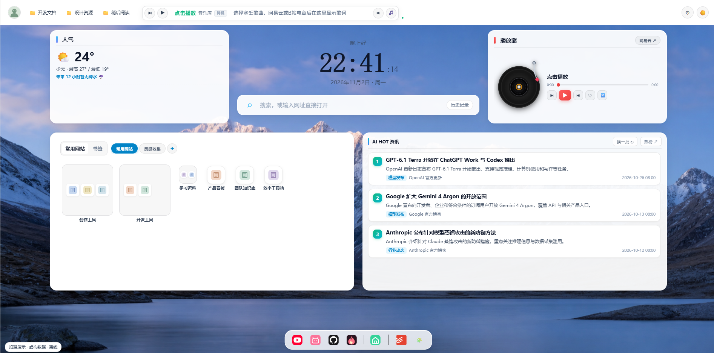
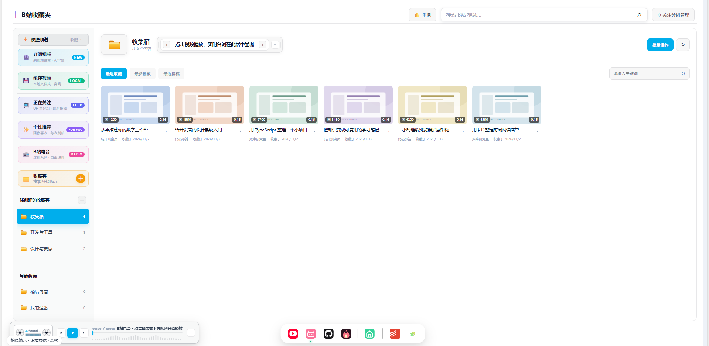
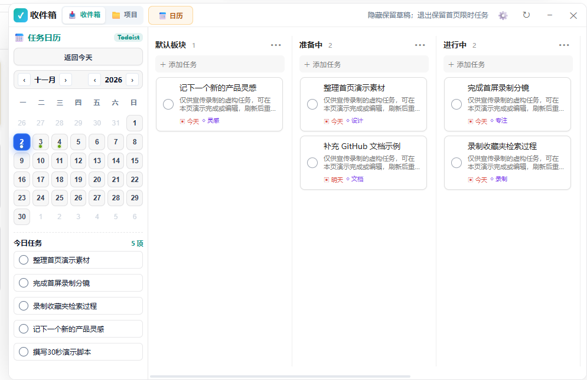

# tab-project

<p align="center">
  
</p>

<p align="center"><strong>A Browser New-Tab Personal Productivity Workspace</strong></p>

<p align="center">
  <a href="https://chromewebstore.google.com/detail/tab-project-%E6%96%B0%E6%A0%87%E7%AD%BE%E9%A1%B5/hogpkihhicjhiakkgjkbchpdoicmbolj"></a>
  <a href="https://microsoftedge.microsoft.com/addons/detail/tabproject-%E6%96%B0%E6%A0%87%E7%AD%BE%E9%A1%B5/dbkaiojfbolnkpaegflocfbdgpmhjcco"></a>
</p>

<p align="center">
  <strong>English</strong> · <a href="README.md">简体中文</a>
</p>

<p align="center">
  <a href="https://chromewebstore.google.com/detail/tab-project-%E6%96%B0%E6%A0%87%E7%AD%BE%E9%A1%B5/hogpkihhicjhiakkgjkbchpdoicmbolj"><strong>Chrome Web Store</strong></a> ·
  <a href="https://microsoftedge.microsoft.com/addons/detail/tabproject-%E6%96%B0%E6%A0%87%E7%AD%BE%E9%A1%B5/dbkaiojfbolnkpaegflocfbdgpmhjcco"><strong>Edge Add-ons</strong></a> ·
  <a href="https://github.com/kongzhuww/tab-project/releases/latest">Release Downloads</a> ·
  <a href="CHANGELOG.md">Changelog</a> ·
  <a href="#quick-guide-which-path-fits-you">Quick Start</a> ·
  <a href="#installation">Installation Guide</a> ·
  <a href="#development">Development</a>
</p>

> **Core Concept**: `tab-project` is a browser new-tab workspace extension built with **Vue 3, TypeScript, and Chromium Manifest V3** (for Google Chrome and Microsoft Edge). It unifies frequently visited websites, bookmark kanban boards, daily tasks, and multimedia widgets—which are typically scattered across different tabs and apps—into a clean, responsive, theme-adaptive command center for your daily workflows.

> **Officially Available on Both Web Stores**:
> - **Chrome Web Store**: [Install tab-project from Chrome Web Store](https://chromewebstore.google.com/detail/tab-project-%E6%96%B0%E6%A0%87%E7%AD%BE%E9%A1%B5/hogpkihhicjhiakkgjkbchpdoicmbolj) (ID: `hogpkihhicjhiakkgjkbchpdoicmbolj`)
> - **Microsoft Edge Add-ons**: [Install tab-project from Edge Add-ons](https://microsoftedge.microsoft.com/addons/detail/tabproject-%E6%96%B0%E6%A0%87%E7%AD%BE%E9%A1%B5/dbkaiojfbolnkpaegflocfbdgpmhjcco)
>
> Store installations do not require Developer mode and benefit from browser-managed automated updates. Each new release requires store review; store updates may lag slightly behind GitHub commits and releases.

> **Repository Version**: **1.0.22**, adding a prompt backpack, AI workspace, and encrypted WebDAV backup safeguards, plus AI Hot and theme updates. Store versions may lag behind GitHub Releases. See the [Changelog](CHANGELOG.md).

---

## Feedback & Updates

[Report a bug](https://github.com/kongzhuww/tab-project/issues/new?template=bug_report.yml) · [Request a feature](https://github.com/kongzhuww/tab-project/issues/new?template=feature_request.yml) · [Discussions](https://github.com/kongzhuww/tab-project/discussions) · [Releases](https://github.com/kongzhuww/tab-project/releases)

Include your installed extension version, browser version, and reproduction steps. Redact private data before sharing screenshots; never post tokens, cookies, or API keys. Edge checks for approved store updates automatically. To follow GitHub releases, select **Watch → Custom → Releases** on this repository.

## Core Features & Module Status

| Capability / Module | Core Functionality | Status Level | Conditions & Requirements |
| :--- | :--- | :--- | :--- |
| **Live Wallpapers & Steam Workshop** | Pure browser Wallpaper Engine runtime, OPFS private caching for zero-dialog cold boot, Steam Workshop (431960) scanning, 4K video / Web interactive / Scene wallpapers, 128-band logarithmic audio visualizer, 5 hardware cooling safeguards for Mac Retina & 120Hz displays | **Available by default** | Browser local OPFS storage; supports direct link to Steam Workshop or custom directories |
| **Favorite Sites & Large Folders** | Multi-group workspaces, 2x2 large folders, drag-and-drop reordering, inline quick title & URL editing | **Available by default** | Stored in local browser storage; basic features are completely offline |
| **Bookmark Kanban & Search** | Grid/tile layout for browser bookmarks, folder tree navigation, drag-and-drop organization, offline Pinyin/fuzzy search via Web Worker | **Available by default** | Requires browser bookmark read permission; never mutates untouched items |
| **Multi-Engine Unified Search** | Blended keyword matching across history, bookmarks, and shortcuts; `/bm` and `/sites` filters; instant redirect to GitHub, Bilibili, NetEase Music, and Qichacha | **Available by default** | Offline-first suggestions; Enter submits query directly to the selected search engine |
| **Clock, Mottos & Weather** | 3D clock with Solar & Lunar calendar, scroll-to-switch mottos, real-time Open-Meteo temperature & urban weather conditions | **Available by default** | Weather fetched via direct, read-only browser requests to Open-Meteo API |
| **Bilibili Plugin & Radio** | Dual-column favorite organization, AI subtitle extraction, picture-in-picture mini-player; Radio uses DASH pure audio streams (~3MB) with auto-failover | **Optional Module** | Public browsing requires no login; accessing personal collections/following requires existing login session in the same browser |
| **GitHub Workspace** | Starred repository classification, multi-rule search, distraction-free Markdown README viewer, one-click issue-to-todo linking | **Optional Module** | Public viewing needs no token; deep queries and task integration require a personal GitHub Token |
| **Todoist Task Kanban** | 0ms offline instant rendering, auto-hierarchical layout mapped from linked GitHub repos, task calendar, and real-time cross-tab cache invalidation | **Optional Module** | Requires a Todoist API Token entered in settings |
| **Music Workspace** | NetEase Cloud Music direct web session login, Monster Siren Records album library, 3D rotating vinyl turntable with synced lyrics display | **Optional Module** | Monster Siren is available out-of-the-box; NetEase requires logging in on the official site in the same browser |
| **AI HOT Intelligence** | Curated daily AI news headlines with an immersive reader; technical trends and papers | **Optional Module** | Ships with curated news feeds and article view |
| **Prompt Backpack** | Organize prompts and saved articles, fill variables and copy prompts | **Optional Module** | Stored locally; encrypted WebDAV backup is available |
| **Multica Agent Workspace** | View tasks, projects and agents; dispatch tasks after confirmation | **Optional Module** | Requires a configured Multica connection |

### Optional Components & Extended Services

| Extended Capability | Core Functionality | Status Level | Conditions & Requirements |
| :--- | :--- | :--- | :--- |
| **Beaver Chatroom** | Private secure chatroom, shared rooms, activity sensing, interactive card sharing, and restricted image messages | **Optional Service (Experimental)** | Disabled by default; toggle in Store; requires self-hosted HTTPS server and dedicated invite |
| **My Memes & Sticker Library** | Sticker picker inside chatroom, local directory mounting via File System Access API, and categorized sticker management | **Auxiliary Module** | Invoked inside the chatroom without a standalone dock icon; mounting local disk requires explicit browser grant |
| **WebDAV Cloud Roaming** | Encrypted backup for shortcuts, settings, backpack and radio; optional startup sync with conflict prompts | **Optional Service** | Requires a WebDAV server, account, app password and separate backup passphrase |

---

## 🎨 Theme & Design Philosophy

- **Unified CSS Variable Theming**: Settings offers Light (`light`), Dark (`dark`) and Warm Paper (compatible with the `lonetrail` key). The retired Endfield UI theme falls back to Dark. Startup animations remain separate from UI themes.
- **Autonomous Modular Design**: Clear boundaries between workspaces and auxiliary plugins, with standardized integration into `src/sdk/` for windows, context menus, notifications, and image viewports.
- **Pure Browser Extension**: Native Host, Native Messaging, hardware device probes, and desktop pets have been completely removed. Media caching and sticker storage use standard browser permissions and APIs.

*Some features remain in active iteration. The YouTube workspace has been removed: upgrading clears its extension-local favorites and settings, and old backups no longer restore them. Your browser login and account playlists are unaffected.*

---

## Screenshots

These screenshots use fictional demo data rather than personal tasks or collections. AI news headlines on the home screen are fictional examples, not factual news or model-release claims. Available features depend on the installed version.

### Home



### Bilibili Plugin



### Todoist Task Kanban



---

## 🧭 Quick Guide: Which Path Fits You?

Choose the best path for your needs:

- **Everyday User (Recommended)**: Install directly from the official store with one click—no developer mode or manual extraction needed, with automatic updates:
  - **Chrome Users**: [Install from Chrome Web Store](https://chromewebstore.google.com/detail/tab-project-%E6%96%B0%E6%A0%87%E7%AD%BE%E9%A1%B5/hogpkihhicjhiakkgjkbchpdoicmbolj).
  - **Edge Users**: [Install from Edge Add-ons](https://microsoftedge.microsoft.com/addons/detail/tabproject-%E6%96%B0%E6%A0%87%E7%AD%BE%E9%A1%B5/dbkaiojfbolnkpaegflocfbdgpmhjcco).
- **Manual / Release Zip**: Read [Manual Installation: Prebuilt Release Packages](#manual-installation-prebuilt-release-packages).
- **Developer / Contributor**: Read [Building from Source](#building-from-source) and [Development Commands](#development).
- **Self-Hosting Beaver Chatroom**: Read the [Private Chat Server Deployment Guide](server/private-chat/README.md).
- **Mobile Support Inquiries**: The project focuses solely on desktop Chromium browsers (Edge / Chrome). Standalone Android / Capacitor builds are retired; the desktop layout features responsive mobile-width adaptation.
- **System Architecture**: Read [System Architecture Design](ARCHITECTURE.md) and [Developer Current State & Actual Entry Points](docs/CURRENT_STATE.md).

---

## 📦 Installation

### Recommended: Install from Official Web Stores (One-Click & Auto Updates)

#### 1. Google Chrome Web Store
1. Open [tab-project on Chrome Web Store](https://chromewebstore.google.com/detail/tab-project-%E6%96%B0%E6%A0%87%E7%AD%BE%E9%A1%B5/hogpkihhicjhiakkgjkbchpdoicmbolj).
2. Click **Add to Chrome** and confirm adding the extension.
3. Open a new tab. If Chrome displays a prompt asking to keep the change, select **Keep changes**.

#### 2. Microsoft Edge Add-ons
1. Open [tab-project on Microsoft Edge Add-ons](https://microsoftedge.microsoft.com/addons/detail/tabproject-%E6%96%B0%E6%A0%87%E7%AD%BE%E9%A1%B5/dbkaiojfbolnkpaegflocfbdgpmhjcco).
2. Click **Get** and confirm adding the extension.
3. Open a new tab. If Edge asks you to confirm the new-tab change, choose to keep this extension.

> **Tip**: Store installations require no Developer mode and are automatically updated by the browser store. GitHub commits, releases, and store reviews are independent, and store review timelines may cause slight delays.

**Switching from an unpacked installation?** The store version may use a different extension ID and will not automatically inherit local data from the development installation. Export important settings first, keep the original installation, and confirm recovery before disabling it. Do not uninstall or clear the original data first.

### Manual Installation: Prebuilt Release Packages

For Chrome users, development, or manual version management, download the latest Release asset.

1. Open [Latest Releases](https://github.com/kongzhuww/tab-project/releases/latest).
2. Download `tab-project-v<version>-extension.zip` and extract it to a persistent local folder.
3. In Microsoft Edge navigate to `edge://extensions`, or in Google Chrome navigate to `chrome://extensions`.
4. Turn on **Developer mode** (toggle in the top-right or sidebar).
5. Click **Load unpacked**, and select the extracted directory containing `manifest.json`.

> **Note**: Do not use GitHub's auto-generated "Source code (zip)" download—it contains uncompiled sources, not the ready-to-run extension build.

*Before upgrading, consider exporting your settings. Keep your extension directory in place; do not uninstall the extension simply to upgrade, as clearing extension data will delete locally stored records.*

### Building from Source

```bash
git clone https://github.com/kongzhuww/tab-project.git
cd tab-project
npm ci
npm run check
```

Once built, load the repository root directory as an unpacked extension following the steps above.

---

## 🚀 Recent Updates

### v1.0.9 · Permission Minimization, Immutable Release Safety & Code Cleanup

- **Manifest Permission Minimization**: Narrowed broad `<all_urls>` to explicit `https://*/*` and `http://*/*`; purged 13 retired domain declarations.
- **Immutable Release & Automated Policy Gates**: Removed `--clobber` overwrite logic in the release workflow; added 51 offline regression tests integrated into CI.
- **Legacy Code & Style Cleanup**: Purged nearly 3,000 lines of retired workspace styles from `newtab-workspaces.css` (reducing bundle size by 66.4KB); generalized Markdown classes; removed all QQ residues. See [v1.0.9 Release Notes](docs/RELEASE_1.0.9.md).

### v1.0.8 · Overlay Sidebar & Native GitHub Lists

- A non-resizing overlay sidebar on new tabs and ordinary webpages, with extension icon, Alt+W, close button, and Esc controls; protected pages do not support injection.
- Star categories use official GitHub Lists with multi-list membership; the special “Currently Using” category has been removed.
- Bilibili favorites search runs on Enter or the search button. See [v1.0.8 Release Notes](docs/RELEASE_1.0.8.md).

### v1.0.5 · My Repositories Topic Kanban, Two-Way Drag & Drop, and Remote Topic Sync

- **GitHub Workspace: "My Repositories · Topic Kanban"**: Left navigation adds an entry to view your repositories arranged in a multi-column horizontal kanban board, with unclassified repositories on the left and GitHub Topics categorized on the right.
- **Bidirectional Drag-and-Drop with Automatic GitHub Sync**: Drag cards between columns; dragging into a Topic column attaches the topic tag and syncs remotely via GitHub API; dragging back removes the tag.
- **Comprehensive Horizontal Navigation**: Supports dragging cards while scrolling the wheel horizontally, `Shift` + mouse wheel scrolling, and auto-scrolling when hovering near board edges (100px).
- **Native Cascading Context Menus**: Right-click cards for options; hover/click "Move to Group" to open a secondary pane with boundary flipping; includes one-click link copying, clone command copying, and GitHub navigation.
- **Layout & Visual Polishing**: Fixed a CSS bug where cards could collapse under vertical pressure (`flex-shrink: 0`), fully conforming to light and dark theme variables.

### v1.0.4 · Radio Safeguards, Smart Failover, and 3-Tier Docs

- **Radio Collection Overwrite Protection**: Eliminated implicit overwrites when saving empty playlist names; empty fields trigger a highlighted shake animation and focus prompt.
- **Smart Failover & Anti-Stall**: Automatically aborts dead retries on timeouts, network errors, or auth limits, with up to 3 fallback source switches.
- **WebDAV Cloud Roaming**: Custom radio station playlists are now backed up and restored via Nutstore / self-hosted WebDAV (`bili_radio_custom_series`).
- **Historical note**: This version included a video recommendation card redesign; the associated workspace was removed in later development.
- **Three-Tier Documentation & Official Theme System**: Established 4 official themes (`light`, `dark`, `endfield`, `lonetrail`) and startup animations (`rhinelab` / `endfield`).
- **Build Optimization**: Cleaned up 847 unused legacy chunk artifacts.

> For older release history and detailed migration logs, see the complete [Changelog (CHANGELOG.md)](CHANGELOG.md).

---

## 🔒 Configuration & Data Boundaries

- Features like GitHub, Todoist, music, and self-hosted chatrooms require their respective user accounts, tokens, or services.
- Chatrooms run on self-hosted servers with personal invite codes; consult the [Server Guide](server/private-chat/README.md).
- `chrome.storage.local` and IndexedDB reside inside the browser sandboxed profile. **This does not equal enterprise end-to-end encryption**; local storage simply means data does not leave your machine unless requested.
- API calls communicate directly with target providers; chat messages are stored on your designated self-hosted server.
- Backing up configurations does not duplicate original media files on disk.
- Never commit private tokens, session cookies, invite credentials, or server keys into public repositories.

---

## 🛡️ Permissions & Privacy Policy

This extension strictly adheres to the **Chromium Manifest V3** security standard. All configurations, bookmark caches, and preferences are **stored locally within your browser by default**. There are zero analytics trackers, telemetry libraries, or commercial ad servers.

### 1. Why Are These Permissions Declared?

| Declared Permission | Purpose & Necessity |
| :--- | :--- |
| `storage` / `unlimitedStorage` | Store shortcuts, custom groups, theme settings, radio queues, and offline caches locally in `chrome.storage.local` and IndexedDB. |
| `bookmarks` | Read browser bookmarks to display in the new-tab kanban grid; support organization, folder creation, and drag-and-drop sorting (indexed locally via Web Worker). |
| `tabs` / `activeTab` | Power the top-bar tab manager (tree display of open tabs, one-click switching), avoiding duplicate opened tabs. |
| `cookies` | Bilibili actions read the `bili_jct` CSRF cookie. NetEase uses website-session requests. The YouTube workspace and its background authentication and cookie diagnostics have been removed; see the [permission audit](docs/MANIFEST_PERMISSION_AUDIT.md). |
| `downloads` | Triggered strictly by user action: exporting configuration backups, downloading cached audio/video, and saving wallpapers. |
| `scripting` | Injects an isolated, non-modal overlay sidebar or web translation helper only on explicit user invocation. The sidebar (suggested shortcut: `Alt+W`) does not resize webpages. Browser internal pages, extension stores and other protected pages cannot be injected. |
| `identity` | Optional Google Calendar OAuth2 authorization for agenda synchronization. |
| `declarativeNetRequest` | Sets required headers for extension-originated Bilibili media and image requests and removes obsolete network rules. |
| `contextMenus` / `clipboardWrite` | Context menus for shortcut cards, and one-click copying of URLs, clone commands, or AI news summaries to clipboard. |

### 2. Where Does Data Go?

- **Zero Third-Party Telemetry**: We do not operate telemetry servers. We do not track user habits, statistics, or navigation history.
- **Direct Official API Communications**:
  - When utilizing Bilibili favorites, GitHub Stars, Todoist tasks, NetEase Cloud Music, or Open-Meteo weather, requests **travel directly between your browser and the respective official service**.
  - Your API tokens and keys remain strictly in local storage and are only sent in request headers to the corresponding official endpoint.
- **Self-Hosted Beaver Chatroom**: Chatrooms are entirely self-hosted. Messages sync only with your specified server address after you manually provide an invite code; no public relay exists.
- **WebDAV Cloud Sync**: Requires a configured server and separate backup passphrase. Backups are encrypted locally; manual operations and optional startup sync are supported, with conflict prompts. Use HTTPS; old server versions and exported files are not automatically deleted.

---

## 💻 Development

```bash
# Watch UI sources and recompile; refresh your browser page to view changes
npm run ui:watch

# Run TypeScript checks and multi-entry builds
npm run check

# Create a clean release package
npm run release:build
```

The project is dedicated to desktop Chromium browsers. Legacy Android / Capacitor toolchains have been removed; responsive styling for narrower browser windows is preserved.

### Directory Structure

```text
src/                 Frontend modules, SDK, and background service workers
server/private-chat/ Self-hosted private chatroom backend
docs/                Architecture, module index, and deployment guides
docs/history/        Historical migration ledgers and audit records
generated/           Compiled assets
manifest.json        Chromium extension manifest (MV3)
```

### Three-Tier Documentation Navigation

- **Tier 1 · Visitors & Everyday Users**: Read this [README.md](README.md) and the [Changelog](CHANGELOG.md).
- **Tier 2 · Developers & Current Entries**: Read [System Architecture](ARCHITECTURE.md) and [Current State & Actual Entry Points](docs/CURRENT_STATE.md).
- **Tier 3 · Module Index & SDK**: Read [Module & Component Index](docs/MODULE_INDEX.md) and [SDK Documentation](src/sdk/README.md).
- **Archives**: Historical migration records and retired proposals are preserved in the [docs/history/ Archive](docs/history/README.md).

---

## 📄 License & Attribution

Original code is licensed under the [MIT License](LICENSE). Third-party components, runtimes, and graphical assets follow their respective licenses. The MIT license of the original code does not imply commercial license for all bundled assets. See [ATTRIBUTION.md](ATTRIBUTION.md) for full details.
