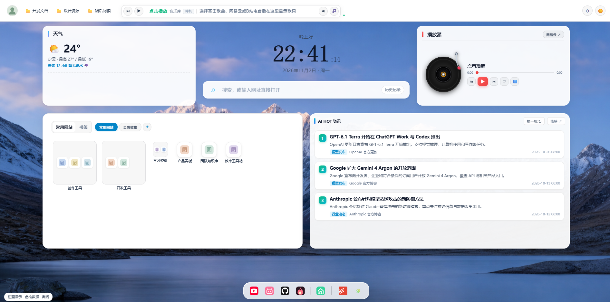
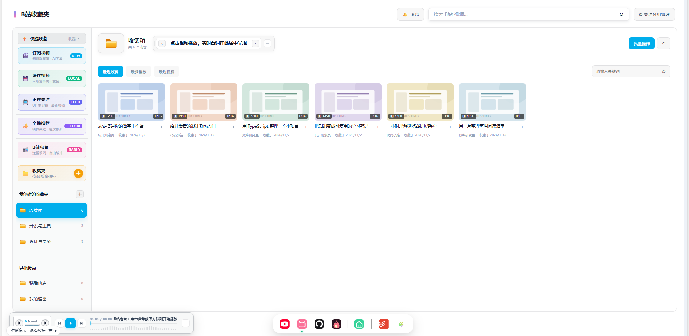
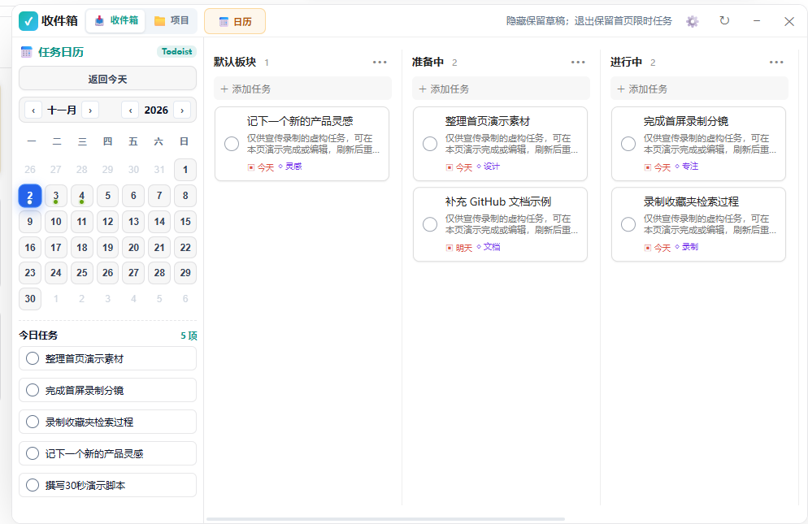

# 公告草稿：tab-project 新标签页正式上架 Edge 商店

> 状态：待作者确认的公告文案，尚未发布到 Discussions 或外部社区。以下正文可用于仓库公告；已补充作者提供并确认公开的首屏、B站与 Todoist 演示图。不上报未经核对的下载量、评分或新版审核结果。

---

# tab-project 新标签页，正式上架 Microsoft Edge 商店了！

终于可以分享这个消息：我开发的 **tab-project 新标签页** 已经正式上架 Microsoft Edge 加载项商店。

从自己使用的新标签页工作台，到能让其他人直接从商店安装的扩展，这是一个很值得纪念的里程碑。感谢一路参与体验和提出建议的人，也欢迎你来试试。

## 为什么做这个项目？

我希望新标签页不只是搜索框和几个网址，而是一个可以按自己的习惯整理的日常入口：常用网站、书签、任务、代码仓库、视频收藏和音乐，不必总是散落在不同页面里。

因此做了 tab-project：以新标签页为核心，按需启用模块，而不是要求每个人使用同一套工作流。

## 可以用来做什么？

- 整理常用网站和书签，使用聚合搜索快速直达。
- 查看时钟、天气，并选择适合自己的界面主题，默认是明亮主题。
- 按需启用 GitHub、Todoist、B站、音乐、AI HOT 与模型价格组件。
- 通过开源仓库了解实现、反馈问题和跟进更新。

不同组件需要各自的账号或配置；海狸聊天室属于默认关闭的实验性可选服务，需要自托管服务器。具体功能请以实际商店安装版本为准。

## 界面预览

以下为虚构数据的演示界面；首屏 AI 资讯标题也属于演示内容，不代表真实新闻或模型发布。功能以实际安装版本为准。

## 去哪里安装？

**[从 Microsoft Edge 商店安装 tab-project 新标签页](https://microsoftedge.microsoft.com/addons/detail/tabproject-%E6%96%B0%E6%A0%87%E7%AD%BE%E9%A1%B5/dbkaiojfbolnkpaegflocfbdgpmhjcco)**

无需开启开发者模式。商店安装可通过 Edge 获取后续审核上线的更新，不必每次手动下载 ZIP。仓库版本可能比商店版本更新，GitHub 发布成功不等于商店新版已上线。

## 欢迎反馈，一起完善

- [报告问题](https://github.com/kongzhuww/tab-project/issues/new?template=bug_report.yml)：请附扩展版本、浏览器版本、复现步骤，以及已遮挡隐私的截图。
- [提出建议](https://github.com/kongzhuww/tab-project/issues/new?template=feature_request.yml)：告诉我你想解决什么问题。
- [参与讨论](https://github.com/kongzhuww/tab-project/discussions)：交流使用体验和整理工作流。
- [查看更新](https://github.com/kongzhuww/tab-project/releases)：正式版本的更新记录。
- [查看源码](https://github.com/kongzhuww/tab-project)：欢迎 Star、交流和贡献。

如果使用后觉得有帮助，也欢迎在商店留下真实评价。感谢支持！
